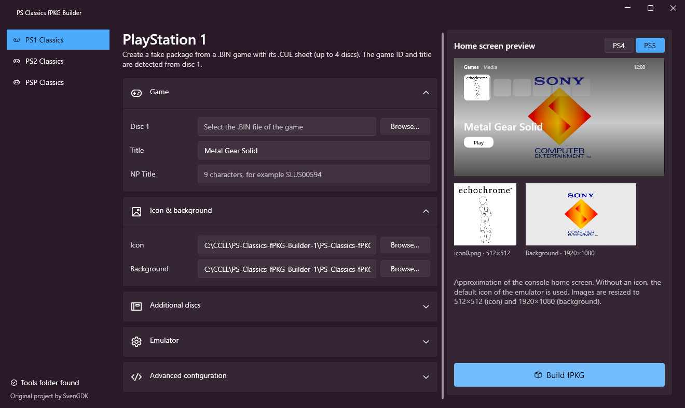

# PS Classics fPKG Builder

> **Maintenance notice:** the original project was abandoned by its author, [SvenGDK](https://github.com/Victor-Hugo-PZ/PS-Classics-fPKG/commits?author=SvenGDK) ([original repository](https://github.com/SvenGDK/PS-Classics-fPKG-Builder)). This fork **continues its development**: bug fixes, dependency updates, automated tests and documentation. All credit for the original work goes to SvenGDK.

## Download

Get the package for your system from the [Releases](https://github.com/Victor-Hugo-PZ/PS-Classics-fPKG/releases) page. Every package includes the .NET runtime, the `Tools` folder and `PkgCheck`, a tool that checks a generated `.pkg`.

| System | File | How to start |
| --- | --- | --- |
| Windows 10/11 | `…Windows.zip` | Extract and run `PS Classics fPKG Builder.exe`. Nothing else to install. |
| Linux x64 | `…Linux-x64.zip` | Install Wine + winetricks, unzip, run `./PSClassicsfPKGBuilder`, press **Wine setup** once. |
| macOS (Apple Silicon) | `…macOS-arm64.zip` | Install Wine + winetricks with Homebrew, open the app (see below), press **Wine setup** once. |
| macOS (Intel) | `…macOS-x64.zip` | Same as above. |

All versions share the same build code (`Shared/PSClassics.Core`), so they produce the same packages, and have the same screens.

- Easily create PS1, PS2 & PSP game fake packages for the PS4 / PS5 on Windows, Linux and macOS
- Supports .BIN files (PS1), .ISO files (PS2 & PSP) and compressed .CSO files (PSP, converted to .ISO automatically)
- Detects PS1 game protection and can apply the required patch
- Automatic PS1 game TOC generation for games using CDDA music, including discs with one BIN file per track (the tracks are joined automatically)
- Add a game from a .zip or .7z: drop the archive on the window, the app extracts it and finds the game files
- Customize the icon & background (PNG, JPG, BMP, GIF, WebP: converted automatically)
- Configure the emulator, with a hint for every option
- Select up to 4 discs on PS1 & up to 5 discs on PS2
- Automatically apply game configs from the database
- Live preview of the icon and background on the PS4 / PS5 home screen
- Check a generated `.pkg` from the app or with `PkgCheck`

**Made for beginners** (new in 2.2):
- English and Portuguese (Brazil) interface, chosen in **Settings** (follows the system language by default)
- **Step-by-step mode**: one step at a time (Game, Images, Options, Review) with Next and Back
- **Drag and drop** the game, images, configs or a `.pkg` anywhere on the window; a `.zip` or `.7z` of a game is opened by itself and its files are found (PS1, PS2, PSP)
- **Find cover**: downloads the PS1/PS2 cover by game ID and creates the icon and background; PSP uses the images stored on the disc
- Emulator **presets** (Recommended, Most compatible, Best looking, Other emulator)
- **Checks before building** (missing files and `.cue`, invalid NP title, free disk space) with the fix for each problem
- **Errors explained in plain words**, with the technical details below
- The package is **checked automatically** after building
- **Queue** of several games: drop or add many `.zip` or `.7z` files and build them one after the other with no questions (cover and title are looked up, a game that fails does not stop the others)
- **Queue settings per game**: the Queue has "Settings for all games" and, for the games you select, their own preset ("Apply to selected"); the others keep following the settings for all games
- **New game**: after a successful build the result window offers "Create another game" (clears the disc, title, images and configs, keeps the emulator options); the "New game" button does the same at any time
- The output folder dialog opens in the folder of the last package, and building a game that is already in the History (package still on disk) shows a warning first
- **Archive check**: a `.zip` or `.7z` is looked into before it is extracted (no game files, a track missing from the `.cue`, a password, not enough disk space)
- **Fix buttons**: an error or a problem found before building can offer the fix (select the game again, Wine setup, show the Tools folder, clear the images, build again)
- **Titles** of PSP games come from the disc; PS1 and PS2 games that are not in the title list get theirs from the Redump database
- **History** of the packages you built, the options used and how each one ran on the console
- Guide section on **installing the package on the console**
- **Update notice** when a new version is released (Settings can turn it off)



## Notes for Linux and macOS users

The PS4 publishing tools (`orbis-pub-cmd`, `gengp4`, `cue2toc`, `pspdecrypt`) are Windows programs, so the app runs them through [Wine](https://www.winehq.org/). Everything else (game IDs, CRCs, images, `param.sfo`, GP4) is done by the app itself.

1. Install Wine and winetricks once:
   - Ubuntu / Debian / Mint: `sudo dpkg --add-architecture i386 && sudo apt update && sudo apt install wine wine32:i386 winetricks`
   - Fedora: `sudo dnf install wine winetricks`
   - Arch: `sudo pacman -S wine winetricks` (multilib enabled)
   - macOS: `brew install --cask --no-quarantine wine-stable` and `brew install winetricks` (Apple Silicon asks for Rosetta 2: accept)
2. Start the app and press **Wine setup** (bottom left), then **Set up Wine**. It creates a Wine prefix only for the app (`~/.local/share/PSClassicsfPKGBuilder/wine-prefix` on Linux, `~/Library/Application Support/PSClassicsfPKGBuilder/wine-prefix` on macOS) and installs the Visual C++ 2008 runtime the tools need.
3. Linux: `./install-shortcut.sh` (in the extracted folder) adds the app to the applications menu.

**macOS, first launch:** the app is not signed with an Apple developer certificate (only ad-hoc signed), so macOS blocks the first launch. Move it to Applications, right-click it and choose **Open** (macOS 15+: try once, then **System Settings › Privacy & Security › Open Anyway**). Or in Terminal: `xattr -dr com.apple.quarantine "/Applications/PS Classics fPKG Builder.app"`.

Advanced: `PSFPKG_WINE` selects a specific Wine binary and `PSFPKG_WINEPREFIX` another prefix.

PS Classics fPKG Builder uses the following tools from other developers:

| Tool | Created by | Repository |
| --- | --- | --- |
| `Cue2toc` | Goatman13 | [https://github.com/Goatman13/Cue2toc](https://github.com/Goatman13/Cue2toc)
| `pspdecrypt` | John-K & More | [https://github.com/John-K/pspdecrypt](https://github.com/John-K/pspdecrypt)
| `crc` | asahui | [https://gist.github.com/asahui/a6af64606a9476a40442274335f5feaf](https://gist.github.com/asahui/a6af64606a9476a40442274335f5feaf) (now reimplemented in the app)
| `wine` | WineHQ | [https://www.winehq.org/](https://www.winehq.org/)
| `LibOrbisPkg` | OpenOrbis (LGPL-3.0) | [https://github.com/OpenOrbis/LibOrbisPkg](https://github.com/OpenOrbis/LibOrbisPkg)
| `DiscUtils` | Kenneth Bell & contributors | [https://github.com/DiscUtils/DiscUtils](https://github.com/DiscUtils/DiscUtils)
| `SkiaSharp` | Mono / .NET Foundation | [https://github.com/mono/SkiaSharp](https://github.com/mono/SkiaSharp)
| `Avalonia` | AvaloniaUI | [https://github.com/AvaloniaUI/Avalonia](https://github.com/AvaloniaUI/Avalonia)
| `WPF-UI` | lepoco | [https://github.com/lepoco/wpfui](https://github.com/lepoco/wpfui)

## Project layout

| Folder | What |
| --- | --- |
| `Shared/PSClassics.Core` | All the build logic (VB.NET, .NET 10, cross-platform). Used by every app. |
| `Shared/PSClassics.Core.Tests` | Unit and integration tests of the build logic (xUnit). |
| `Windows/PS Classics fPKG Builder` | Windows app (WPF + WPF-UI). |
| `CrossPlatform/PSClassicsfPKGBuilder` | Linux and macOS app (Avalonia), same screens as the Windows app. |
| `Windows/PkgCheck` | `PkgCheck` command line tool (runs on every OS). |
| `legacy/` | The original Linux (Avalonia 11) and macOS (Swift) apps, replaced by `CrossPlatform/`. Kept for reference only. |

## Building from source
Requirements: the [.NET 10 SDK](https://dotnet.microsoft.com/download). (To only run a release you need nothing: the packages include the .NET runtime.)

```
git clone --recurse-submodules https://github.com/Victor-Hugo-PZ/PS-Classics-fPKG.git
cd PS-Classics-fPKG
dotnet build "Windows/PS Classics fPKG Builder.sln"          # Windows app
dotnet build CrossPlatform/PSClassicsfPKGBuilder.sln         # Linux / macOS app (also builds on Windows)
```

- [LibOrbisPkg](https://github.com/OpenOrbis/LibOrbisPkg) is a git submodule (`external/LibOrbisPkg`) and is compiled together with the app. If you cloned without `--recurse-submodules`, run `git submodule update --init`.
- The third-party tools and emulators are **not** part of this repository (they are git-ignored). Extract the `Tools` folder of a Windows release (this fork's or the [original one](https://github.com/SvenGDK/PS-Classics-fPKG-Builder/releases/tag/v1)) into the repository root (`Tools/`). The build copies it next to the executable when it exists.
- Run: `dotnet run --project "Windows/PS Classics fPKG Builder"` or `dotnet run --project CrossPlatform/PSClassicsfPKGBuilder`.

## Checking a generated .pkg
The app has a **Check a .pkg** button. It runs the checker of the PS4 publishing tools (`orbis-pub-cmd img_verify`, with the standard fake package passcode) plus structural checks (file size, `param.sfo`, `icon0.png`), and shows the result in two groups:
- **Problems**: findings that may stop the package from installing or running.
- **Expected for fake packages**: Sony certification rules that every fake package fails (`pronunciation.xml`, `changeinfo`, "test package, not for submission", SELF `sceversion` format…). They are safe to ignore.

### PkgCheck (command line tool)
`PkgCheck` is included in every release, next to the app (inside the `.app` bundle on macOS: `Contents/MacOS/PkgCheck`):

```
PkgCheck game.pkg                 full check with the SDK checker (can take minutes on large games)
PkgCheck game.pkg --quick         structural checks only, instant, no Tools folder or Wine needed
PkgCheck game.pkg --tool-output   also prints the complete output of the SDK checker
```
Exit code: `0` no problems, `1` problems found, `2` the check could not run (bad arguments, missing file or tools). That makes it usable in scripts.

The same check with the SDK tool directly: `Tools\PS4\mod-pub\orbis-pub-cmd-3.38.exe img_verify --passcode 00000000000000000000000000000000 game.pkg` (and `img_info` / `img_file_list --no_passcode` to inspect it). LibOrbisPkg's `PkgTool pkg_validate` is another option, but it always reports the three digests as invalid because packages are built with `--skip_digest`.

## Building a release
- Windows: `.\scripts\build-release.ps1 -Version 2.2.0` → `dist\PS.Classics.fPKG.Builder.v2.2.0.Windows.zip` (self-contained; `-FrameworkDependent` for a smaller zip).
- Linux: `scripts/build-release.sh 2.2.0 linux-x64` → `dist/PS.Classics.fPKG.Builder.v2.2.0.Linux-x64.zip`.
- macOS (on a Mac): `scripts/build-release.sh 2.2.0 osx-arm64` (or `osx-x64`) → `dist/PS.Classics.fPKG.Builder.v2.2.0.macOS-arm64.zip` with an ad-hoc signed `.app`.
- All of them at once on GitHub: run the **Release packages** workflow (Actions tab) with the version. It builds the four packages as artifacts; it does not publish a release.

## Running the tests
```
dotnet test "Windows/PS Classics fPKG Builder.sln"     # Windows: Core tests + Windows UI tests
dotnet test CrossPlatform/PSClassicsfPKGBuilder.sln    # any OS: Core tests
```
- Unit tests cover the game databases, emulator configuration, `param.sfo`, GP4 editing, ISO/UDF helpers, image conversion, game ID / CRC detection and the PSP EBOOT patching.
- Integration tests run the real tools (`cue2toc`, `gengp4`, `orbis-pub-cmd`, through Wine on Linux/macOS) and build complete PS1, PS2 and PSP packages from small synthetic discs. They are **skipped** when the `Tools` folder (or, on Linux/macOS, a ready Wine prefix) is not available. The CI runs them on Linux with Wine.

## Project status
- [x] Windows app migrated from .NET Framework 4.8.1 to .NET 10, LibOrbisPkg built from source
- [x] Build logic extracted into a cross-platform, tested library (`Shared/PSClassics.Core`)
- [x] 2.2.5: create another game after a build (New game button), a different preset for some games of the queue, the output folder dialogs open in the last folder, a warning when a game was already built
- [x] 2.2.4: PSP .cso support, queue of several games, archive check, fix buttons, titles from the PSP disc and Redump
- [x] 2.2.3: PS1 games with one BIN file per track (for example Tekken 3) build; the game ID no longer keeps the folder of the BOOT file; the cover search reads the serials of multi-track games; drop a .zip or .7z to add a game
- [x] Fixed: PS1 discs 3/4 ignored, unterminated `--path-patches`, lost PS2 emulator fixes, pipe deadlocks, leaked file handles, working-directory dependent paths, PS1 TOC for every disc, PS2 game ID derived from the NP title when it is not detected
- [x] Fluent interface with a live PS4/PS5 home screen preview, help buttons, Required/Optional badges and hints
- [x] `.pkg` checker in the app and as `PkgCheck`
- [x] One Linux/macOS app (Avalonia) with the same screens and the same build code as Windows; `strings`, `7z` and `crc` replaced by managed code (same results, verified by tests against the original tools)
- [ ] Try the 2.2.4 and 2.2.5 features with real files: a PSP `.cso` of a real game, the Queue window with several games (also with a preset chosen for some of them), the Fix buttons, and the New game / Create another game buttons (tested by code, not by clicking)
- [ ] Test the Linux and macOS packages on real machines (the Linux build is tested by the CI with Wine; macOS only builds in the CI)
- [ ] Verify on a real console: which background the home screen shows (the user image is written as `pic0.png`, while the emulators ship a `pic1.png`), PS2 `-vu0-opt-flags` (single dash in the original), the PS3 config (`--lopnor-config`) for database configs, and `disc2.toc` to `disc4.toc` of multi-disc PS1 games
